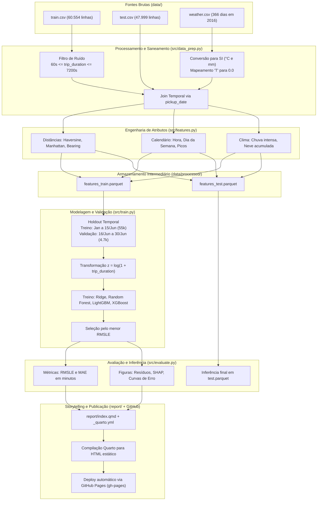

# Arquitetura do Pipeline, Domínio e Contratos Técnicos (Gate 3)

Documento de especificação técnica e topologia do pipeline de dados, machine learning e publicação para o projeto `improve_traffic`.

---

## 1. Visão Geral e Mapeamento Metodológico

A arquitetura do projeto organiza as seis fases de Data Analytics (*Ask, Prepare, Process, Analyze, Share, Act*) em quatro camadas técnicas desacopladas:

1. **Camada de Ingestão e Saneamento (`Process`)**: Responsável por ler os dados brutos validados no Gate 1, aplicar as conversões de unidades acordadas, sanear ruídos operacionais e unificar as bases de corridas e clima.
2. **Camada de Engenharia de Atributos (`Process`)**: Executa transformações geométricas espaciais (Haversine, Manhattan e bearing), decompõe componentes temporais e cria variáveis derivadas de pico e clima.
3. **Camada de Modelagem e Avaliação (`Analyze`)**: Executa a partição temporal, treina modelos supervisionados candidatos (Baseline Ridge, Random Forest, LightGBM, XGBoost), calcula métricas e extrai interpretabilidade de atributos.
4. **Camada de Storytelling e Deploy (`Share` e `Act`)**: Consome os dados sumarizados, tabelas e figuras geradas no pipeline para compilar o relatório interativo via Quarto e publicá-lo no GitHub Pages.

---

## 2. Diagrama de Fluxo e Topologia do Pipeline



---

## 3. Especificação Modular e Contratos de Interface (CLI)

Todo o código de aplicação residirá sob `src/`. Cada script opera como módulo executável independente com interface de linha de comando usando `argparse`.

### 3.1. `src/utils.py` (Módulo de Funções Puras e Vetorizadas)
Concentra a matemática sem estado e utilitários compartilhados:
- `haversine_distance(lon1, lat1, lon2, lat2) -> np.ndarray`: Distância em linha reta sobre esfera terrestre (retorna km).
- `manhattan_distance(lon1, lat1, lon2, lat2) -> np.ndarray`: Distância em malha ortogonal aproximada (retorna km).
- `calculate_bearing(lon1, lat1, lon2, lat2) -> np.ndarray`: Ângulo da rota em graus (0° a 360°).
- `fahrenheit_to_celsius(f_temp) -> np.ndarray`: Conversão $(F - 32) \times 5 / 9$.
- `inches_to_mm(inches) -> np.ndarray`: Conversão $\text{inches} \times 25.4$.
- `rmsle_score(y_true, y_pred) -> float`: Raiz do erro quadrático médio na escala logarítmica.

### 3.2. `src/data_prep.py` (Ingestão, Limpeza e Join)
- **Comando**: `python src/data_prep.py --train data/train.csv --test data/test.csv --weather data/weather.csv --out-dir data/processed/`
- **Operações**:
  1. Carrega as três bases e verifica a presença das colunas obrigatórias conforme os contratos do Gate 1.
  2. Converte temperaturas para °C e precipitação/neve para mm. Mapeia caracteres `"T"` para `0.0`.
  3. No treino, remove registros ruidosos com `trip_duration < 60` ou `trip_duration > 7200` segundos.
  4. Extrai a data de embarque (`pickup_date = pickup_datetime.dt.date`) e faz o merge à esquerda com `weather.csv`.
- **Saídas**:
  - `data/processed/clean_train.parquet`
  - `data/processed/clean_test.parquet`

### 3.3. `src/features.py` (Engenharia de Atributos)
- **Comando**: `python src/features.py --in-dir data/processed/ --out-dir data/processed/`
- **Operações**:
  1. Calcula `dist_haversine_km`, `dist_manhattan_km` e `bearing_deg`.
  2. Decompõe `pickup_datetime` em: `hour` (0-23), `dayofweek` (0-6), `month` (1-6), `is_weekend` (0 ou 1).
  3. Cria variáveis de faixa de tráfego: `is_morning_rush` (07h às 09h em dias úteis) e `is_evening_rush` (16h às 19h em dias úteis).
  4. Cria indicadores geográficos binários de proximidade aos aeroportos: `is_jfk` e `is_lga`.
  5. Cria indicadores meteorológicos combinados: `is_rainy` (`precipitation_mm > 0`) e `has_snow_ground` (`snow_depth_mm > 0`).
- **Saídas**:
  - `data/processed/features_train.parquet`
  - `data/processed/features_test.parquet`

### 3.4. `src/train.py` (Treinamento e Validação Temporal)
- **Comando**: `python src/train.py --in-dir data/processed/ --models-dir models/ --eval-date 2016-06-16`
- **Operações**:
  1. Carrega `features_train.parquet`.
  2. Divide a amostra com base na data de corte: registros antes de 16/06 formam o treino de validação; registros de 16/06 em diante formam o conjunto de validação temporal (4.749 amostras).
  3. Aplica a transformação alvo $z = \log(1 + y)$.
  4. Ajusta e compara quatro arquiteturas:
     - Baseline Ridge com padronização prévia.
     - Random Forest Regressor.
     - LightGBM Regressor.
     - XGBoost Regressor.
  5. Serializa os pesos do modelo campeão em `models/best_model.joblib` e exporta o histórico de scores em `models/metrics_summary.json`.

### 3.5. `src/evaluate.py` (Avaliação e Exportação de Artefatos)
- **Comando**: `python src/evaluate.py --models-dir models/ --features-dir data/processed/ --reports-dir reports/`
- **Operações**:
  1. Carrega o modelo selecionado e calcula as métricas finais de validação (RMSLE e MAE em minutos).
  2. Gera gráficos diagnósticos: dispersão predito vs real, distribuição de resíduos e importância de variáveis por ganho ou SHAP.
  3. Salva os gráficos em formato estático de alta resolução em `reports/figures/`.
  4. Executa inferência sobre `features_test.parquet`, reverte a escala logarítmica e exporta o arquivo de submissão padronizado em `data/processed/submission.csv` com colunas `id` e `trip_duration`.

---

## 4. Esquema de Diretórios Físicos

```text
improve_traffic/
├── .github/
│   └── workflows/
│       └── deploy-report.yml     # Workflow de compilação Quarto e deploy no GitHub Pages
├── data/
│   ├── train.csv                 # Bruto original (60.554 registros)
│   ├── test.csv                  # Bruto original (47.999 registros)
│   ├── weather.csv               # Bruto original (366 dias)
│   └── processed/                # Artefatos Parquet gerados pelo pipeline
│       ├── clean_train.parquet
│       ├── clean_test.parquet
│       ├── features_train.parquet
│       ├── features_test.parquet
│       └── submission.csv        # Previsões finais para o conjunto de teste
├── docs/
│   ├── 01-data-discovery-and-contracts.md
│   ├── 02-PRD-and-specs.md
│   ├── 03-architecture-and-schema.md
│   └── adr/
│       ├── 0001-modular-pipeline-architecture.md
│       ├── 0002-temporal-validation-strategy.md
│       └── 0003-quarto-and-github-pages-publication.md
├── models/
│   ├── best_model.joblib         # Modelo vencedor serializado
│   └── metrics_summary.json      # Tabela de RMSLE e MAE de todos os modelos
├── report/
│   ├── _quarto.yml               # Configuração do tema, layout e metadados do Quarto
│   ├── index.qmd                 # Documento principal estruturado nas 6 fases analíticas
│   └── styles.css                # Ajustes tipográficos para leitura executiva
├── reports/
│   └── figures/                  # Gráficos estáticos gerados por evaluate.py
├── src/
│   ├── __init__.py
│   ├── utils.py                  # Funções puras (Haversine, Manhattan, conversões de unidade)
│   ├── data_prep.py              # Ingestão, saneamento de extremos e join
│   ├── features.py               # Extração de variáveis espaciais, temporais e climáticas
│   ├── train.py                  # Partição temporal e treino comparativo de modelos
│   └── evaluate.py               # Avaliação, diagnóstico visual e geração de submissão
├── environment.yml               # Especificação de dependências Conda/Mamba
├── Makefile                      # Orquestrador leve para invocar os estágios em sequência
└── README.md                     # Documentação de entrada do repositório
```

---

## 5. Arquitetura da Camada de Apresentação (Quarto e GitHub Pages)

### 5.1. Estrutura Narrativa do Relatório (`report/index.qmd`)
O arquivo do Quarto será redigido em conformidade com as seis fases analíticas:
- **1. Ask (Pergunta e Negócio)**: Apresentação do contexto urbano, gargalos de tráfego de Nova York e hipóteses de trabalho.
- **2. Prepare (Dados e Auditoria)**: Resumo dos dados de entrada, diagnóstico das fontes brutas e correção documentada das unidades meteorológicas.
- **3. Process (Limpeza e Engenharia)**: Filtros de ruído de duração, fórmulas de distâncias espaciais e integração temporal com o clima.
- **4. Analyze (Modelagem e Descobertas)**: Análise exploratória visual, comparação de desempenho dos modelos em validação temporal e importância dos fatores de tráfego.
- **5. Share (Interpretação e Visualização)**: Gráficos de dispersão, comportamento por faixa horária e síntese de cenários climáticos severos.
- **6. Act (Recomendações Práticas)**: Diretrizes operacionais para operadores de frota e gestão de tráfego urbano em dias de tempestade.

### 5.2. Pipeline de Deploy Automatizado
O deploy será gerenciado por uma GitHub Action configurada em `.github/workflows/deploy-report.yml`:
1. Disparo a cada `git push` na branch `main`.
2. Instalação do Quarto e dependências Python mínimas.
3. Execução de `quarto render report/`.
4. Publicação automática dos arquivos estáticos compilados na branch `gh-pages`.

---

## 6. Índice de Registros de Decisão Arquitetural (ADRs)

| ADR | Título | Status |
| :--- | :--- | :--- |
| [0001](adr/0001-modular-pipeline-architecture.md) | Arquitetura Modular do Pipeline em Scripts Python Desacoplados | Aprovado |
| [0002](adr/0002-temporal-validation-strategy.md) | Estrutura de Validação Temporal com Corte em Junho | Aprovado |
| [0003](adr/0003-quarto-and-github-pages-publication.md) | Publicação Contínua de Relatório Técnico via Quarto e GitHub Pages | Aprovado |
