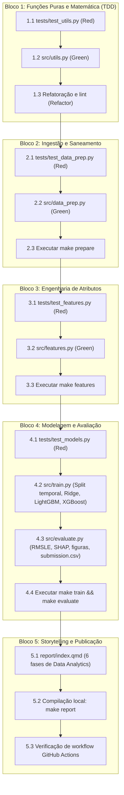

# Plano Sequencial de Implementação e Estratégia de Testes (Gate 5)

Documento operacional de decomposição do trabalho em tarefas atômicas, ordenadas por dependência de código, com matriz de testes TDD e comandos de verificação automatizada.

---

## 1. Grafo de Precedência Técnica



---

## 2. Estratégia de Testes Automatizados (Matriz TDD)

Os testes são orientados pelo framework `pytest`. Cada módulo possui casos de borda e tolerâncias numéricas definidas previamente:

| Módulo de Teste | Arquivo Alvo | O que Valida | Casos Críticos e Tolerâncias |
| :--- | :--- | :--- | :--- |
| `tests/test_utils.py` | `src/utils.py` | Geometria espacial e conversões físicas | JFK até Times Square (~21 km Haversine); 14/02/2016 (-1°F = -18,33°C); 23/01/2016 (27.3 in = 693,42 mm); `pytest.approx(tol=1e-2)`. |
| `tests/test_data_prep.py` | `src/data_prep.py` | Ingestão, saneamento de ruído e join | Zero nulos em `clean_train.parquet`; descarte de viagens $< 60\text{s}$ e $> 7200\text{s}$; mapeamento de `"T"` para `0.0`. |
| `tests/test_features.py` | `src/features.py` | Vetorização de features | Colunas de pico binárias (`is_morning_rush`, `is_evening_rush`); valores finitos em `bearing_deg` $[0, 360]$; ausência de NaNs em Parquet. |
| `tests/test_models.py` | `src/train.py` | Partição temporal e pipeline de ML | Treino contém apenas datas $\le$ 15/06/2016; validação temporal contém apenas datas de 16/06 a 30/06; formato de predições $> 0$. |

---

## 3. Checklist Atômico de Tarefas

### Bloco 1: Funções Puras e Matemática Vetorizada (`src/utils.py`)
- [ ] **Tarefa 1.1**: Criar `tests/test_utils.py` cobrindo:
  - Distância Haversine entre pontos conhecidos em Nova York (ex.: Central Park até aeroporto JFK).
  - Distância Manhattan retilínea.
  - Cálculo de azimute de deslocamento (*bearing*).
  - Conversão de Fahrenheit para Celsius e polegadas para milímetros.
  - Cálculo da métrica RMSLE com valores sintéticos esperados.
- [ ] **Tarefa 1.2**: Implementar `src/utils.py` com funções vetorizadas puras em NumPy sem estado interno.
- [ ] **Tarefa 1.3**: Rodar testes unitários e linting:
  ```bash
  pytest tests/test_utils.py
  ruff check src/utils.py tests/test_utils.py
  ```

### Bloco 2: Ingestão, Saneamento e Join Temporal (`src/data_prep.py`)
- [ ] **Tarefa 2.1**: Criar `tests/test_data_prep.py` testando contratos e integridade:
  - Checagem da existência de colunas após a união.
  - Garantia de que nenhuma viagem com `trip_duration < 60` ou `trip_duration > 7200` persista no treino limpo.
  - Garantia de que a base climática não contenha strings residuais `"T"`.
- [ ] **Tarefa 2.2**: Implementar `src/data_prep.py` com interface CLI via `argparse`:
  - Carregamento de `data/train.csv`, `data/test.csv` e `data/weather.csv`.
  - Conversão de tipos e unidades climáticas para o Sistema Internacional.
  - Saneamento de outliers de duração no conjunto de treino.
  - Join à esquerda pela data truncada (`pickup_date`).
  - Gravação dos artefatos em `data/processed/clean_train.parquet` e `data/processed/clean_test.parquet`.
- [ ] **Tarefa 2.3**: Executar e validar o estágio:
  ```bash
  make prepare
  pytest tests/test_data_prep.py
  ```

### Bloco 3: Engenharia de Atributos Vetorizada (`src/features.py`)
- [ ] **Tarefa 3.1**: Criar `tests/test_features.py` para verificar a consistência dos atributos gerados:
  - Presença das novas colunas espaciais (`dist_haversine_km`, `dist_manhattan_km`, `bearing_deg`).
  - Presença dos atributos temporais (`hour`, `dayofweek`, `month`, `is_weekend`, `is_morning_rush`, `is_evening_rush`).
  - Presença dos atributos climáticos combinados (`is_rainy`, `has_snow_ground`).
  - Presença de indicadores aeroportuários (`is_jfk`, `is_lga`).
- [ ] **Tarefa 3.2**: Implementar `src/features.py` com interface CLI:
  - Cálculo vetorizado das distâncias e ângulos de percurso.
  - Extração de componentes de calendário e marcação de faixas de pico comercial.
  - Bounding boxes geográficas de aproximação aos aeroportos JFK e LaGuardia.
  - Gravação em `data/processed/features_train.parquet` e `data/processed/features_test.parquet`.
- [ ] **Tarefa 3.3**: Executar e validar:
  ```bash
  make features
  pytest tests/test_features.py
  ```

### Bloco 4: Modelagem com Validação Temporal e Inferência (`src/train.py` e `src/evaluate.py`)
- [ ] **Tarefa 4.1**: Criar `tests/test_models.py` validando os requisitos de corte temporal:
  - Teste garantindo que a partição de treino não contenha registros com data de embarque posterior a 15/06/2016.
  - Teste assegurando que o conjunto de validação temporal contenha exclusivamente a segunda quinzena de junho.
- [ ] **Tarefa 4.2**: Implementar `src/train.py`:
  - Partição temporal com corte em `2016-06-16`.
  - Transformação do alvo $z = \log(1 + y)$.
  - Pipeline de pré-processamento (imputação se necessária, one-hot encoding para variáveis categóricas como `vendor_id` e `store_and_fwd_flag`).
  - Ajuste comparativo de 4 modelos: Ridge Linear, Random Forest, LightGBM e XGBoost.
  - Seleção do modelo campeão pelo menor RMSLE na validação de junho.
  - Gravação de `models/best_model.joblib` e `models/metrics_summary.json`.
- [ ] **Tarefa 4.3**: Implementar `src/evaluate.py`:
  - Cálculo e log de métricas finais (RMSLE e MAE em minutos).
  - Cálculo de importância de atributos e análise via SHAP.
  - Exportação de figuras estáticas de alta resolução em `reports/figures/` (dispersão predito vs real, resíduos e importância de variáveis).
  - Inferência sobre `features_test.parquet` com reversão exponencial da predição ($\hat{y} = \exp(\hat{z}) - 1$).
  - Exportação do arquivo final de submissão em `data/processed/submission.csv` com colunas `id` e `trip_duration`.
- [ ] **Tarefa 4.4**: Executar e validar o estágio:
  ```bash
  make train
  make evaluate
  pytest tests/test_models.py
  ```

### Bloco 5: Storytelling no Quarto e Deploy no GitHub Pages (`report/index.qmd`)
- [ ] **Tarefa 5.1**: Redigir `report/index.qmd` estruturado integralmente nas 6 fases de Data Analytics:
  - **Ask**: Declaração do problema, contexto urbano de Nova York, objetivos e hipóteses centrais (H1, H2, H3).
  - **Prepare**: Metadados das tabelas, comprovação das unidades climáticas reais (°F e polegadas) e catálogo de dados.
  - **Process**: Regras de saneamento de outliers (60s a 7200s), formulações geométricas de distância e integração com clima.
  - **Analyze**: Análise exploratória espacial e sazonal, validação com corte temporal em junho, tabela comparativa dos 4 modelos e métricas alcançadas (RMSLE e MAE).
  - **Share**: Gráficos diagnósticos de resíduos, importância de atributos pelo modelo vencedor e curva de degradação em dias chuvosos e nevados.
  - **Act**: Recomendações estratégicas e operacionais para gestão de frota, precificação e rotas alternativas em eventos climáticos severos.
- [ ] **Tarefa 5.2**: Compilar localmente o relatório via Quarto:
  ```bash
  make report
  ```
  Verificar que `report/_site/index.html` foi gerado sem erros de execução de células ou figuras quebradas.
- [ ] **Tarefa 5.3**: Revisar configuração da GitHub Action em `.github/workflows/deploy-report.yml` para garantir que o deploy na branch `gh-pages` esteja operacional.

---

## 4. Comandos de Verificação Automatizada

Para validar a integridade de ponta a ponta durante e ao término da implementação:

```bash
# 1. Checagem de estilo e padrões de código
ruff check src/ tests/

# 2. Execução de toda a suíte de testes unitários e de integração
pytest tests/ -v

# 3. Execução completa do pipeline de dados, treino e avaliação
make all

# 4. Verificação dos artefatos gerados
test -f data/processed/clean_train.parquet && echo "clean_train: OK"
test -f data/processed/clean_test.parquet && echo "clean_test: OK"
test -f data/processed/features_train.parquet && echo "features_train: OK"
test -f data/processed/features_test.parquet && echo "features_test: OK"
test -f models/best_model.joblib && echo "best_model: OK"
test -f data/processed/submission.csv && echo "submission: OK"
test -f report/_site/index.html && echo "report_site: OK"
```

---

## 5. Critérios de Aceite Final para Conclusão do Projeto

1. **Testes Verificados**: 100% dos testes unitários e de integração em `tests/` executando com sucesso no pytest.
2. **Métricas Atingidas**: Modelo vencedor atingindo RMSLE $\le 0.40$ no conjunto de validação temporal da segunda quinzena de junho.
3. **Submissão Completa**: Arquivo `data/processed/submission.csv` contendo exatamente 47.999 linhas (mesma volumetria de `data/test.csv`), sem valores nulos ou durações negativas.
4. **Relatório Quarto Compilado**: Site estático compilado sem avisos ou erros na pasta `report/_site/`, pronto para deploy no GitHub Pages.
