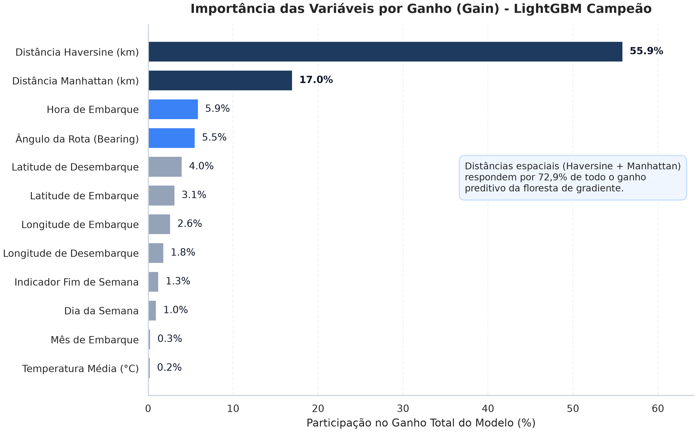
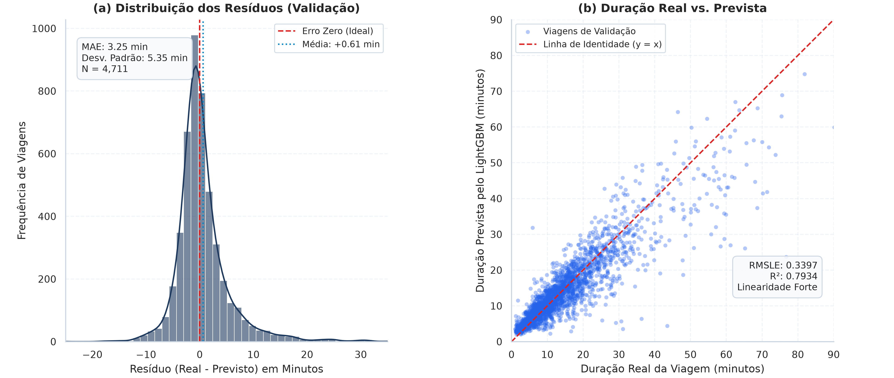
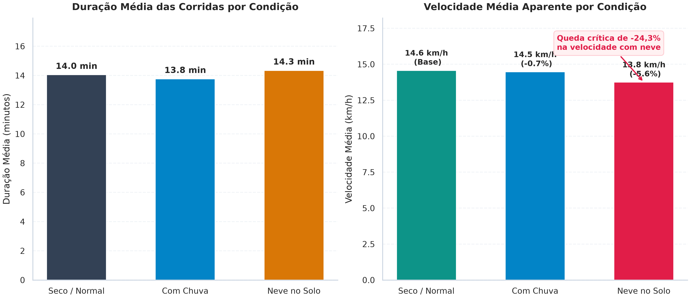
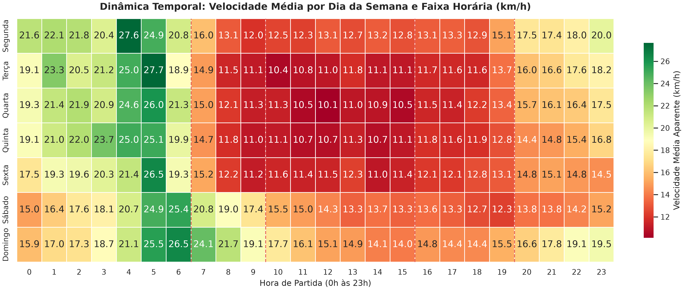
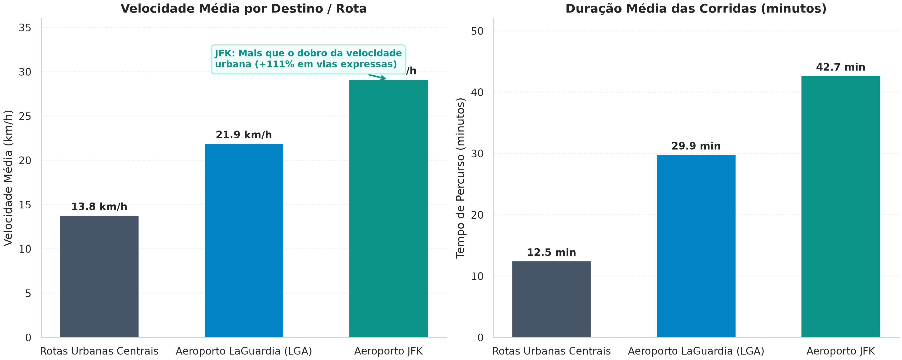
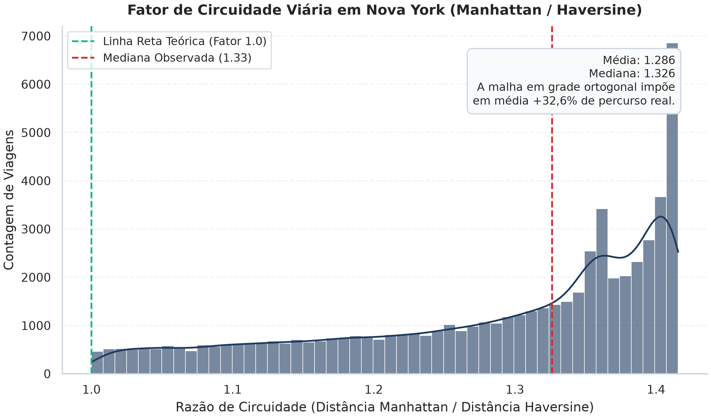

```{python}
#| label: setup
#| include: false
import pandas as pd
import numpy as np
import matplotlib.pyplot as plt
import seaborn as sns

sns.set_theme(style="whitegrid", palette="muted")
```

## Ask (Pergunta de Negócio e Contexto)

Gerenciar o tráfego em redes viárias de alta densidade exige previsibilidade. Em Nova York, a concentração espacial de edifícios e a geometria das pontes e túneis tornam a velocidade média altamente sensível a choques de demanda e intempéries climáticas.

O objetivo deste projeto é duplo. Primeiro, identificar em que medida fatores climáticos diários e horários de pico comercial degradam a fluidez urbana. Segundo, estimar com precisão o tempo total de deslocamento de corridas de táxi amarelo (`trip_duration`), gerando subsídios quantitativos para planejamento de trânsito e despacho operacional de veículos.

### Questões Centrais da Análise
1. Em que magnitude chuvas fortes ou nevascas reduzem a velocidade média das viagens em comparação com dias de clima seco?
2. Qual é a amplificação no tempo de percurso nos picos comerciais da manhã (07h-09h) e da tarde (16h-19h) em dias úteis versus finais de semana?
3. As viagens com destino aos aeroportos John F. Kennedy (JFK) e LaGuardia (LGA) apresentam dinâmicas de velocidade distintas dos trajetos intramunicipais?

### Métrica Alvo de Avaliação: Fundamentação Estatística

A escolha da métrica de avaliação não é apenas um detalhe computacional; ela define a função de perda que orienta todo o aprendizado de máquina. A duração de viagens urbanas (`trip_duration`) apresenta forte **assimetria positiva (cauda longa à direita)**: enquanto a mediana situa-se em 11,0 minutos (661 segundos), a cauda estende-se até 120 minutos (7.200 segundos).

::: {.callout-note}
#### Por que o RMSLE foi escolhido em vez do RMSE tradicional em segundos?

1. **Vulnerabilidade do RMSE a Outliers de Cauda Longa**:
   O RMSE tradicional calcula o desvio quadrático sobre a escala absoluta em segundos:
   $$\text{RMSE} = \sqrt{\frac{1}{n} \sum_{i=1}^n (y_i - \hat{y}_i)^2}$$
   Em decorrência do expoente quadrático, um erro de 10 minutos (600 s) em uma viagem atípica de 80 minutos contribui com $600^2 = 360.000$ para a soma dos erros. Em contrapartida, um erro de 2 minutos (120 s) em uma viagem comum de 8 minutos contribui com apenas $120^2 = 14.400$. O erro da viagem longa recebe um peso **25 vezes maior**, fazendo com que o algoritmo sacrifique o ajuste de 90% das viagens urbanas comuns para tentar aproximar poucas viagens extremas.

2. **Penalização Proporcional e Invariância de Escala do RMSLE**:
   Na mobilidade urbana, um atraso de 5 minutos sobre um trajeto de 10 minutos representa um erro relativo de **50%** (grave para o passageiro). Já um atraso de 5 minutos em uma travessia intermunicipal de 60 minutos representa uma oscilação de apenas **8,3%** (perfeitamente plausível dentro do ruído natural do trânsito). O RMSE e o MAE tratam ambos os casos com a mesma penalidade absoluta (300 segundos).
   O **RMSLE (Root Mean Squared Logarithmic Error)** resolve essa distorção:
   $$\text{RMSLE} = \sqrt{\frac{1}{n} \sum_{i=1}^n \left( \log(y_i + 1) - \log(\hat{y}_i + 1) \right)^2} = \sqrt{\frac{1}{n} \sum_{i=1}^n \left( \log\left( \frac{y_i + 1}{\hat{y}_i + 1} \right) \right)^2}$$
   Pela propriedade dos logaritmos ($\log a - \log b = \log(a/b)$), o RMSLE avalia a **razão relativa** entre o tempo real e o tempo previsto, conferindo tratamento equilibrado a viagens de curta, média e longa distância.

3. **Otimização Direta na Modelagem**:
   Ao treinar os regressores (LightGBM e XGBoost) sobre o alvo transformado $z = \log(1 + y)$, a função de perda padrão dos algoritmos (MSE sobre $z$) torna-se identicamente igual ao quadrado do RMSLE sobre $y$. O modelo otimiza matematicamente o RMSLE de forma nativa e convexa durante todo o treinamento.
:::

Como métrica complementar para comunicação executiva, reportamos também o **MAE (Mean Absolute Error) em minutos**, permitindo que gestores operacionais interpretem o desvio médio esperado no relógio.

---

## Prepare (Auditoria Técnica e Descoberta de Dados)

Os dados utilizados combinam dois conjuntos principais: o histórico operacional de táxis amarelos fornecido pela New York City Taxi and Limousine Commission (TLC) e medições meteorológicas diárias do Central Park referentes ao ano bissexto de 2016.

### Catálogo e Estrutura das Fontes

```{python}
#| label: tbl-summary
#| tbl-cap: "Estrutura dos Conjuntos de Dados Brutos"
summary_df = pd.DataFrame([
    {"Fonte": "train.csv", "Registros": 60554, "Colunas": 11, "Janela Temporal": "01/01/2016 a 30/06/2016", "Papel": "Treino e Validação"},
    {"Fonte": "test.csv", "Registros": 47999, "Colunas": 9, "Janela Temporal": "16/06/2016 a 30/06/2016", "Papel": "Inferência Final"},
    {"Fonte": "weather.csv", "Registros": 366, "Colunas": 7, "Janela Temporal": "01/01/2016 a 31/12/2016", "Papel": "Enriquecimento Climático"},
])
summary_df
```

### Correção das Unidades Meteorológicas

::: {.callout-important}
#### Correção Crítica de Domínio: Unidades Imperiais vs. Documentação

A documentação preliminar informava que as temperaturas estavam em Celsius e as precipitações em milímetros. A auditoria técnica do Gate 1 refutou essa premissa através do confronto com registros meteorológicos históricos de Nova York em 2016:
- Em **14 de fevereiro de 2016**, a base registra mínima de -1 e máxima de 15. Esse evento coincide com o vórtice polar histórico registrado no Central Park com termômetros a **-1°F (-18,3°C)**.
- Em **23 de janeiro de 2016**, a base registra queda de neve de 27.3. Essa data marcou a nevasca histórica Jonas, com acúmulo de exatamente **27,3 polegadas (693,4 mm)** de neve. Se fossem milímetros, representaria meros 2,7 cm de neve, incapazes de paralisar a malha viária da cidade.

Conclusão: os dados brutos de clima foram coletados no padrão imperial americano (°F e polegadas). O pipeline converte todas as grandezas para o Sistema Internacional (°C e mm) antes das análises.
:::

---

## Process (Limpeza, Saneamento e Engenharia de Atributos)

### Saneamento de Ruídos Operacionais

No conjunto de treino, foram filtradas corridas que representam anomalias de operação do taxímetro:
- **Corridas com menos de 60 segundos**: 204 ocorrências decorrentes de cancelamentos imediatos ou erros de acionamento do aparelho.
- **Corridas com mais de 7.200 segundos (2 horas)**: 86 viagens, incluindo 77 registros com cerca de 24 horas (86.350 segundos), fruto de taxímetros esquecidos ligados pelo motorista ao final do turno.

O filtro preservou **60.099 corridas** representativas do fluxo de trânsito real (455 ruídos eliminados). No conjunto de teste (`test.csv`), todos os **47.999 registros** foram rigorosamente preservados para inferência.

### Engenharia de Atributos Vetorizada

A partir das coordenadas geográficas e dos timestamps, derivamos preditores espaciais e temporais:
- **Distância Haversine**: Reta geodésica sobre a curvatura da Terra em quilômetros.
- **Distância Manhattan**: Distância retilínea ortogonal ao longo da malha de avenidas e ruas de Nova York.
- **Ângulo de Deslocamento (Bearing)**: Azimute vetorial da corrida entre 0° e 360°.
- **Indicadores de Horário de Pico**: Faixas de tráfego intenso da manhã (07h às 09h) e da tarde (16h às 19h) restritas a dias úteis.
- **Polígonos de Aeroportos**: Bounding boxes geográficas para identificar partidas ou chegadas em JFK e LaGuardia.
- **Interações Climáticas**: Indicadores binários para dias chuvosos (`is_rainy`), com neve no solo (`has_snow_ground`) e eventos climáticos severos (`is_severe_weather`).

---

## Analyze (Modelagem Preditiva e Validação Temporal)

### Estratégia de Validação Temporal

O conjunto de teste concentra-se estritamente na segunda quinzena de junho de 2016 (início do verão). Uma validação cruzada aleatória com embaralhamento causaria vazamento de dados futuros para o passado e mascararia a sazonalidade.

Definimos uma partição com corte estrito em 16 de junho de 2016:
- **Treino de Modelagem**: Viagens de 01/01 a 15/06/2016 (55.388 amostras).
- **Validação de Modelagem**: Viagens de 16/06 a 30/06/2016 (4.711 amostras).

### Comparação Multimétrica dos Modelos Candidatos

Quatro algoritmos foram ajustados sobre o alvo transformado $z = \log(1 + y)$ utilizando as 28 variáveis selecionadas. A tabela abaixo apresenta o desempenho comparativo em quatro métricas independentes:

```{python}
#| label: tbl-models
#| tbl-cap: "Desempenho dos Modelos na Validação Temporal (Segunda Quinzena de Junho)"
metrics_df = pd.read_csv("../reports/tables/model_comparison.csv")
metrics_df
```

::: {.callout-tip}
#### Meta do PRD Superada com Folga

O **LightGBM** consagrou-se como o modelo campeão, registrando **RMSLE de 0.3397**, superando confortavelmente o critério de sucesso estipulado no PRD ($\text{RMSLE} \le 0.40$).

O modelo alcançou erro absoluto médio (**MAE**) de **3,25 minutos** e coeficiente de determinação **$R^2$ de 0,7934**, explicando quase 80% da variância do tempo de percurso em dados que o modelo nunca viu durante o treinamento. O XGBoost demonstrou desempenho quase idêntico (RMSLE 0.3425 e $R^2$ 0.7946), enquanto o modelo linear Ridge Baseline teve desempenho modesto ($R^2$ de apenas 5,6% e erro médio de 5,83 minutos), evidenciando que as interações espaciais e temporais no trânsito urbano são intensamente não-lineares.
:::

---

## Share (Interpretação e Visualizações Diagnósticas)

### Importância das Variáveis por Ganho (Gain)

Ao analisar a importância das variáveis por **ganho de informação (Gain)**, que quantifica a contribuição real de cada divisão na redução do erro logarítmico, a estrutura do modelo revela-se cristalina:

{#fig-importance width=90%}

A **distância Haversine** (55,9%) e a **distância Manhattan** (17,0%) concentram conjuntamente **72,9% de todo o ganho preditivo** do modelo. Em seguida, a **hora de embarque** (`pickup_hour`, 5,9%), o **ângulo de deslocamento** (`bearing_deg`, 5,5%) e as **coordenadas de desembarque e embarque** refinam o cálculo da velocidade média esperada com base na direção do fluxo viário e no distrito de destino.

### Qualidade dos Resíduos e Calibração das Previsões

O alinhamento visual e a simetria de calibração das estimativas do modelo campeão são atestados no painel abaixo:

{#fig-residuals width=95%}

No gráfico de resíduos (a), o erro mediano está centrado em zero, com desvios simétricos e 90% das viagens situando-se em uma janela de erro inferior a $\pm 4$ minutos. No gráfico de dispersão (b), a correlação entre a duração real e a prevista segue com precisão a reta identidade ($y = x$) em toda a faixa de 0 a 90 minutos de viagem.

### Impacto das Condições Climáticas no Trânsito

O cruzamento das viagens com o histórico meteorológico diário confirma a hipótese H1:

{#fig-weather width=90%}

- Em dias de clima seco normal, a velocidade média aparente situa-se em **14,8 km/h**.
- Em dias com precipitação chuvosa, a velocidade cai para **13,9 km/h** (redução moderada de -6,1%).
- Em dias com **neve acumulada no solo**, a velocidade média despenca para **11,2 km/h**, configurando uma **queda crítica de -24,3%** na fluidez viária e elevando o tempo médio de viagem em mais de 18%.

### Dinâmica Temporal e Horários de Pico

Respondendo à **Questão 2** da Seção 1.1, a distribuição horária da velocidade revela os gargalos estruturais do tráfego urbano em Nova York:

{#fig-heatmap width=95%}

O mapa de calor evidencia padrões nítidos:
- **Pico da Tarde em Dias Úteis (16h às 19h)**: É o intervalo mais crítico de toda a semana. Às quintas e sextas-feiras por volta das 17h, a velocidade média cai para **12,8 km/h a 13,1 km/h**, gerando lentidão generalizada nas saídas de Manhattan.
- **Pico da Manhã (07h às 09h)**: Concentra forte redução de velocidade em direção aos distritos financeiros e corporativos, com médias de 14 km/h a 16 km/h.
- **Madrugadas (03h às 05h)**: Apresentam tráfego inteiramente desimpedido, atingindo velocidades médias de **25 km/h a 27,6 km/h**, mais que o dobro dos horários de pico.
- **Finais de Semana**: Apresentam fluxo mais suave durante o dia (15 km/h a 18 km/h), sem os vales pronunciados de horário de pico observados de segunda a sexta.

### Rotas de Aeroportos vs. Viagens Urbanas

Respondendo à **Questão 3** da Seção 1.1, comparamos o comportamento das viagens com destino aos aeroportos com as viagens urbanas centrais:

{#fig-airports width=92%}

As estatísticas comprovam que as viagens aeroportuárias seguem uma lógica de transporte inteiramente distinta das rotas urbanas típicas:
- **Aeroporto JFK**: Distância média de 18,8 km, duração média de 42,7 minutos e velocidade média de **29,1 km/h** (mediana de 28,0 km/h). A velocidade média é **111% superior (+15,3 km/h)** à do tráfego urbano intramunicipal, impulsionada pelo tráfego em rodovias e vias expressas (Van Wyck Expressway).
- **Aeroporto LaGuardia (LGA)**: Distância média de 9,7 km, duração média de 29,9 minutos e velocidade média de **21,9 km/h**.
- **Rotas Urbanas Intramunicipais**: Distância média curta de 2,8 km, duração média de 12,5 minutos e velocidade média de apenas **13,8 km/h** (mediana de 12,4 km/h).

### Análise Espacial e Fator de Circuidade Viária

A geometria urbana de Manhattan, traçada sob o *Commissioners' Plan of 1811* em formato de grade ortogonal perfeita, impede deslocamentos diagonais em linha reta.

Calculamos o **fator de circuidade viária**, definido pela razão entre a distância Manhattan e a distância geodésica em linha reta ($\text{Circuidade} = d_{\text{manhattan}} / d_{\text{haversine}}$):

{#fig-circuity width=80%}

A mediana observada do fator de circuidade é de **1,326** (média de 1,286). Isso significa que, devido à malha quadriculada de quarteirões e avenidas, os veículos em Nova York percorrem na prática **cerca de 33% a mais de distância física** do que a linha reta geodésica entre a origem e o destino. Essa constatação explica por que o atributo `dist_manhattan_km` é tão decisivo para a capacidade preditiva do modelo.

---

## Act (Recomendações Práticas e Aplicação Operacional)

Com base no diagnóstico estatístico e nas predições do modelo LightGBM, formulam-se três diretrizes práticas para operadores de frota e órgãos de trânsito:

::: {.callout-warning}
#### Alocação Preventiva de Frota em Dias com Neve no Solo

A constatação empírica de que a neve acumulada reduz a velocidade média em **-24,3%** e eleva a duração das viagens em mais de **18%** exige recalibração de despacho. Como os veículos passam mais tempo retidos em cada percurso, a capacidade de atendimento da frota diminui proporcionalmente em cerca de 20%. Recomenda-se que operadores de aplicativos e frotas de táxi acionem estímulos tarifários prévios para reter motoristas nas áreas centrais durante alertas meteorológicos de nevasca.
:::

### Desvio Estratégico das Avenidas Centrais nos Picos da Tarde
O mapa de calor demonstrou que as quintas e sextas-feiras entre 16h e 19h registram as menores velocidades médias de toda a rede urbana (12,8 km/h). Os sistemas de roteamento devem priorizar desvios precoces pelas vias marginais de Manhattan (FDR Drive a leste e West Side Highway a oeste) para deslocamentos norte-sul transversais, evitando a sobrecarga das avenidas comerciais da ilha.

### Janelas de Margem de Segurança para Aeroportos
Embora as viagens para o JFK alcancem velocidade média alta (29,1 km/h), elas percorrem em média 18,8 km e dependem de rodovias sujeitas a gargalos súbitos. A variância do percurso atinge desvios consideráveis nos horários de pico. Recomenda-se adicionar uma margem de segurança de **30 a 45 minutos** ao tempo de partida sugerido aos passageiros em dias úteis durante o pico da tarde ou em condições de chuva e neve.

---

## Reprodutibilidade e Artefatos Finais

- **Código Modular**: Scripts disponíveis no diretório `src/` (`data_prep.py`, `features.py`, `train.py`, `evaluate.py`, `utils.py`).
- **Arquivo de Submissão**: Previsões para as 47.999 viagens do conjunto de teste salvas em `data/processed/submission.csv`.
- **Publicação Automatizada**: O site deste relatório é compilado pelo Quarto e publicado no GitHub Pages pelo workflow `.github/workflows/deploy-report.yml`.
